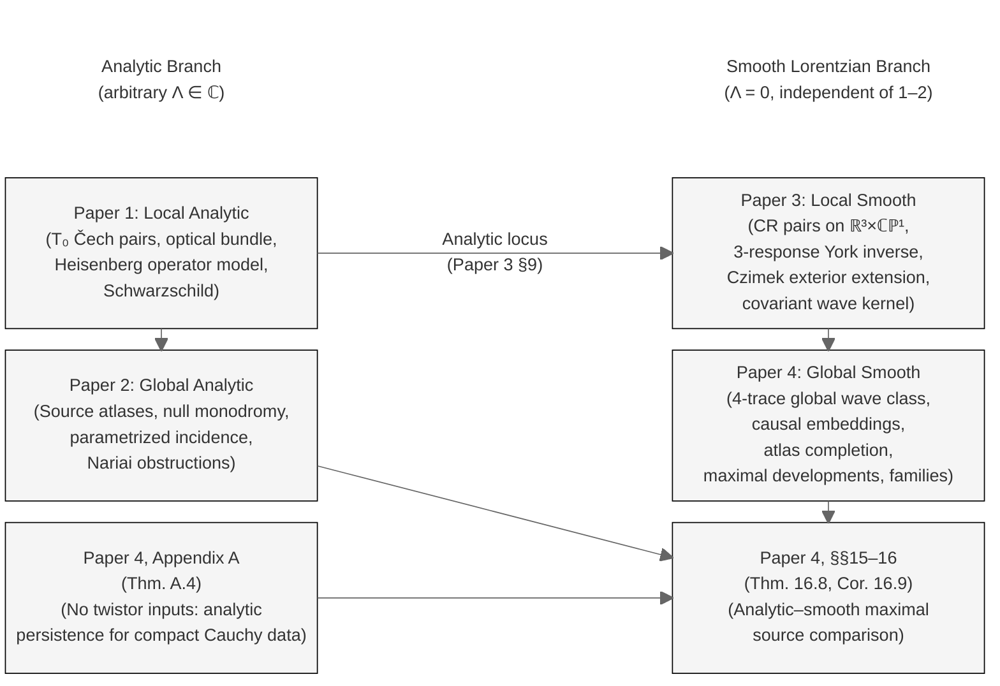

# Two-Chirality Twistor Correspondences for Einstein Geometry

**Lior Isthmus** · [ORCID 0009-0004-7908-9876](https://orcid.org/0009-0004-7908-9876) · [lioristhmus@proton.me](mailto:lioristhmus@proton.me)

These four preprints address Penrose’s gravitational googly problem. What twistor data determine a four-dimensional Einstein geometry when both chiralities of gravity interact? We construct local and global correspondences for analytic Einstein geometry at each fixed cosmological constant, and for smooth Lorentzian vacuum gravity, with the global smooth result formulated on globally hyperbolic spacetimes.

---

## The Four-Paper Series

| # | Scope | Paper & Links | Main Result |
| --- | --- | --- | --- |
| **1** | **Local · Analytic** Any fixed $\Lambda\in\mathbb{C}$ | **A projective twistor correspondence for local analytic Einstein germs** *(v1.1)* [Repo](https://github.com/lioristhmus/projective-twistor-einstein-germs) · [PDF](https://github.com/lioristhmus/projective-twistor-einstein-germs/releases/download/paper-v1.1/projective-twistor-einstein-germs-v1.1.pdf) · [Hexagon v2](https://hexagonmath.org/2611.00123v2) · [Zenodo](https://doi.org/10.5281/zenodo.24197319) · [Computations](#paper-1-local-analytic-einstein-germs) | Two twistor cohomology classes of weights $+2$ and $-6$ recover every marked local analytic Einstein germ, of any Weyl type, through a convergent construction. |
| **2** | **Global · Analytic** Any fixed $\Lambda\in\mathbb{C}$ | **Global twistor sources for analytic Einstein spacetimes** *(v1.0.1)* [Repo](https://github.com/lioristhmus/global-twistor-sources) · [PDF](https://github.com/lioristhmus/global-twistor-sources/releases/download/v1.0.1/global-twistor-sources-en-v1.0.1.pdf) · [Hexagon v2](https://hexagonmath.org/2611.00425v2) · [Zenodo](https://doi.org/10.5281/zenodo.24239028) · [Computations](#paper-2-global-analytic-einstein-spacetimes) | Atlases of these local pairs, two descriptions using null monodromy, and holomorphic spin Einstein four-manifolds form four equivalent categories. |
| **3** | **Local · Smooth** $\Lambda=0$ | **A two-chirality twistor correspondence for smooth Lorentzian Ricci-flat germs** *(v1.1)* [Repo](https://github.com/lioristhmus/smooth-twistor-germs) · [PDF](https://github.com/lioristhmus/smooth-twistor-germs/releases/download/v1.1/smooth-twistor-germs-en-v1.1.pdf) · [Hexagon v2](https://hexagonmath.org/2611.00698v2) · [Zenodo](https://doi.org/10.5281/zenodo.24498374) · [Computations](#paper-3-smooth-lorentzian-vacuum-germs) | Every marked smooth Lorentzian vacuum germ admits a presentation by two hypersurface-twistor CR classes whose Cauchy development recovers the metric at its physical scale. |
| **4** | **Global · Smooth** $\Lambda=0$ | **Global wave completion and recognition of smooth twistor sources** *(v1.1)* [Repo](https://github.com/lioristhmus/smooth-global-twistor-sources) · [PDF](https://github.com/lioristhmus/smooth-global-twistor-sources/releases/download/v1.1/smooth-global-twistor-sources-en-v1.1.pdf) · [Hexagon v1](https://hexagonmath.org/2611.00888v1) · [Zenodo](https://doi.org/10.5281/zenodo.24498661) · [Computations](#paper-4-global-wave-completion) | A global wave kernel class extends the correspondence to globally hyperbolic vacuum spacetimes, where maximal developments of fixed marked initial data correspond to terminal twistor sources. |

---

## Where to Start

- **Twistor gravity — A convergent two-class correspondence and Penrose’s active patching.** For each fixed cosmological constant, two analytic Čech classes of weights $+2$ and $-6$ on a fixed twistor germ recover every marked local analytic Einstein germ, of any Weyl type ([Paper 1, Thm. 2.4](https://github.com/lioristhmus/projective-twistor-einstein-germs/blob/main/release/paper-v1.1/manuscript.md#thm:gg-main)). The correspondence realizes Penrose’s 2015 active-patching proposal in a projective Heisenberg operator model ([Thm. 9.12](https://github.com/lioristhmus/projective-twistor-einstein-germs/blob/main/release/paper-v1.1/manuscript.md#thm:gg-unified-projective-gravitational-correspondence)).
- **Schwarzschild near the future horizon and the comparison with Adamo et al. (2026).** Proposition 10.5 gives piecewise finite-readout optical bounds for a compact family of nonradial trajectories crossing the horizon ([Paper 1, §10](https://github.com/lioristhmus/projective-twistor-einstein-germs/blob/main/release/paper-v1.1/manuscript.md#10-schwarzschild-near-the-future-horizon)). The calibrated comparison of local primitives specifies the projector and residue conventions ([App. K.5](https://github.com/lioristhmus/projective-twistor-einstein-germs/blob/main/release/paper-v1.1/manuscript.md#k5-a-calibrated-schwarzschild-source-primitive)).
- **Global twistor geometry — Null monodromy and the Nariai obstruction.** Null monodromy and parametrized incidence give an equivalence between four descriptions of global holomorphic Einstein geometry, from atlases of two-class data to oriented spin Einstein four-manifolds ([Paper 2, Thm. 1.1](https://github.com/lioristhmus/global-twistor-sources/blob/main/paper/manuscript.md#thm:global-source-correspondence-v08)). Nariai spacetime shows why the choice of description matters. No Hausdorff contact space carries the full complex skies over all its real points ([Thm. 8.2](https://github.com/lioristhmus/global-twistor-sources/blob/main/paper/manuscript.md#thm:nariai-no-hausdorff-whole-sky-carrier)), and in the product complexification each real point sky has nonclosed saturation ([Thm. 8.6](https://github.com/lioristhmus/global-twistor-sources/blob/main/paper/manuscript.md#thm:nariai-all-real-nonclosed-point-skies-v09)).
- **Smooth vacuum gravity — Two-class presentations of every marked Lorentzian vacuum germ.** Two hypersurface-twistor CR cohomology classes encode vacuum initial data whose Cauchy development recovers the germ at its physical scale ([Paper 3, Thm. 1.1](https://github.com/lioristhmus/smooth-twistor-germs/blob/v1.1/paper/smooth-twistor-germs-en-v1.1.md?plain=1#L48)). In the forward construction, three negative contact responses yield the flat scalar and York inverses ([Thm. 4.12](https://github.com/lioristhmus/smooth-twistor-germs/blob/v1.1/paper/smooth-twistor-germs-en-v1.1.md?plain=1#L3375), [code](https://github.com/lioristhmus/smooth-twistor-germs/blob/main/computations/green.py)). In the converse direction, a relative extension based on Czimek’s exterior construction gives a presentation for every such germ ([Thm. 5.7](https://github.com/lioristhmus/smooth-twistor-germs/blob/v1.1/paper/smooth-twistor-germs-en-v1.1.md?plain=1#L4615), [App. B](https://github.com/lioristhmus/smooth-twistor-germs/blob/v1.1/paper/smooth-twistor-germs-en-v1.1.md?plain=1#L8083)).
- **Microlocal analysis / AQFT — Four Cauchy traces determine the global Hadamard singularity class.** Among scalar bisolutions modulo smooth kernels, the four traces on the entire product of one Cauchy hypersurface with itself characterize the canonical class ([Paper 4, Thm. 4.4](https://github.com/lioristhmus/smooth-global-twistor-sources/blob/v1.1/paper/smooth-global-twistor-sources-en-v1.1.md?plain=1#L843) and [Thm. 4.5](https://github.com/lioristhmus/smooth-global-twistor-sources/blob/v1.1/paper/smooth-global-twistor-sources-en-v1.1.md?plain=1#L901)). A flat-torus example shows why the full product matters. Its bisolution vanishes near the diagonal yet has singularities at distant pairs of points ([Ex. 4.7](https://github.com/lioristhmus/smooth-global-twistor-sources/blob/v1.1/paper/smooth-global-twistor-sources-en-v1.1.md?plain=1#L952), [code](https://github.com/lioristhmus/smooth-global-twistor-sources/blob/main/computations/check.py)).
- **Mathematical GR / PDE — Analytic persistence for compact Cauchy data.** Every smooth globally hyperbolic vacuum development of compact connected analytic Cauchy data admits a unique compatible real-analytic structure in which the metric and initial embedding are analytic ([Paper 4, Appendix A, Thm. A.4](https://github.com/lioristhmus/smooth-global-twistor-sources/blob/v1.1/paper/smooth-global-twistor-sources-en-v1.1.md?plain=1#L4743)). The proof uses no twistor-correspondence inputs. Theorem 16.8 uses this result to identify the smooth and analytic maximal developments.
- **Category theory — Descent and terminal developments.** Compatible local twistor atlases descend under the global admission conditions, and global completion is fully faithful. For fixed marked vacuum initial data, the maximal globally hyperbolic development corresponds to a terminal object in the category of twistor source developments ([Paper 4, Thms. 1.3–1.4](https://github.com/lioristhmus/smooth-global-twistor-sources/blob/v1.1/paper/smooth-global-twistor-sources-en-v1.1.md?plain=1#L132)).

---

## Computational Supplements

### Paper 1. Local analytic Einstein germs

The 28 records include exact checks of twistor formulas and numerical diagnostics for the record recursion. [Check index](https://github.com/lioristhmus/projective-twistor-einstein-germs/blob/paper-v1.1/computations/CHECKS.md) · [Supplement ZIP](https://github.com/lioristhmus/projective-twistor-einstein-germs/releases/download/paper-v1.1/local-einstein-computations-0.2.0-r3.zip)

### Paper 2. Global analytic Einstein spacetimes

The 68 symbolic checks cover Nariai curvature, null and conic geometry, tractor normalizations, and curvature and contracted Bianchi identities in Gaussian coordinates. [Check index](https://github.com/lioristhmus/global-twistor-sources/blob/v1.0.1/computations/CHECKS.md) · [Source ZIP including the supplement](https://github.com/lioristhmus/global-twistor-sources/releases/download/v1.0.1/global-twistor-sources-v1.0.1-source.zip)

### Paper 3. Smooth Lorentzian vacuum germs

The additional experiments test York inversion, free-space transport, and reconstruction and extension of a smooth nonanalytic vacuum plane wave. [Original checks](https://github.com/lioristhmus/smooth-twistor-germs/blob/v1.1/computations/README.md) ([ZIP](https://github.com/lioristhmus/smooth-twistor-germs/releases/download/v1.0/smooth-twistor-germs-computations-v1.0.zip)) · [Additional experiments](https://github.com/lioristhmus/smooth-twistor-germs/blob/v1.1/additional-computations/paper3-smooth-twistor-additional-computations-2026-11-24-r2/README.md) ([ZIP](https://github.com/lioristhmus/smooth-twistor-germs/releases/download/v1.1/paper3-smooth-twistor-additional-computations-2026-11-24-r2.zip)).

### Paper 4. Global wave completion

The additional experiments follow wave kernels on Kasner and torus backgrounds, including Cauchy-surface transport and singularities away from the diagonal. [Original checks](https://github.com/lioristhmus/smooth-global-twistor-sources/blob/v1.1/computations/README.md) ([ZIP](https://github.com/lioristhmus/smooth-global-twistor-sources/releases/download/v1.0/smooth-global-twistor-sources-computations-v1.0.zip)) · [Additional experiments](https://github.com/lioristhmus/smooth-global-twistor-sources/blob/v1.1/additional-computations/paper4-global-wave-additional-computations-2026-11-24-r2/README.md) ([ZIP](https://github.com/lioristhmus/smooth-global-twistor-sources/releases/download/v1.1/paper4-global-wave-additional-computations-2026-11-24-r2.zip)).

---

## Logical Architecture & Modularity

The smooth Lorentzian correspondence (Papers 3–4) does **not** logically depend on Papers 1–2 except in the dedicated analytic-locus comparison sections (Paper 3 §9; Paper 4 §§15–16). Paper 4 Appendix A uses no twistor-correspondence inputs and feeds into the analytic–smooth marked development comparison (Theorem 16.8, Corollary 16.9).

---

## Status, Verification Scope & Lean Progress

All four manuscripts are unrefereed preprints on classical four-dimensional gravity. [Paper 4, §§17.2–17.3](https://github.com/lioristhmus/smooth-global-twistor-sources/blob/v1.1/paper/smooth-global-twistor-sources-en-v1.1.md?plain=1#L4490) discusses the scope of the correspondence. Critical scrutiny, counterexamples, and independent verification of the manuscripts are welcome.

<strong>Computational checks and Lean formalization</strong>

- **Reproducible computations:** Each repository ships pinned Docker configurations, exact inputs, negative controls, recorded results, and `SHA256SUMS` manifests. Paper 1's `independent/` witness group is a separate-implementation cross-check (not third-party certification); its 28 primary records include both exact symbolic/finite checks and numerical diagnostics/observations. These computations verify selected identities and examples—**they do not formally certify the analytic convergence, topological, or categorical proofs of the manuscripts.**
- **Lean 4 formalization:** A Lean 4 formalization of Paper 1 is in progress in a private repository, with the coefficient comparison in Theorem 6.3 as the current milestone toward the main correspondence in Theorem 2.4.

**Licenses:** Manuscripts, documentation, and recorded data are **CC BY 4.0**; code is **Apache-2.0**.