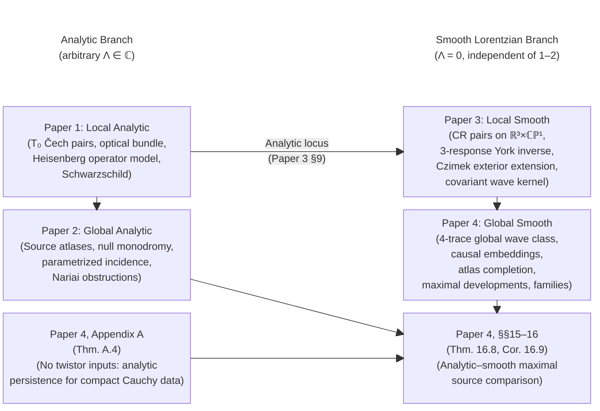

# Two-Chirality Twistor Correspondences for Einstein Geometry

**Lior Isthmus** · [ORCID 0009-0004-7908-9876](https://orcid.org/0009-0004-7908-9876) · [lioristhmus@proton.me](mailto:lioristhmus@proton.me)

This series develops twistor descriptions of four-dimensional Einstein geometry that retain both chiralities of gravity. It gives local and global results in two settings: analytic Einstein geometry at a fixed cosmological constant and smooth Lorentzian vacuum geometry.

---

## The Four-Paper Series

| # | Scope | Paper & Links | Reproducible Computations |
| --- | --- | --- | --- |
| **1** | **Local · Analytic** (arbitrary $\Lambda \in \mathbb{C}$, all Weyl types) | **A projective twistor correspondence for local analytic Einstein germs** *(v1.1)* [Repo](https://github.com/lioristhmus/projective-twistor-einstein-germs) · [PDF](https://github.com/lioristhmus/projective-twistor-einstein-germs/releases/download/paper-v1.1/projective-twistor-einstein-germs-v1.1.pdf) · [Hexagon](https://hexagonmath.org/2611.00123v2) · [Zenodo](https://doi.org/10.5281/zenodo.24197319) | 28 primary records (22 exact checks, 6 numerical diagnostics/observations) + 1 separate-implementation 7-metric witness group (SageMath/SymPy, [guide](https://github.com/lioristhmus/projective-twistor-einstein-germs/blob/main/computations/README.md)) |
| **2** | **Global · Analytic** (arbitrary $\Lambda \in \mathbb{C}$, null monodromy, Nariai obstructions) | **Global twistor sources for analytic Einstein spacetimes** *(v1.0.1)* [Repo](https://github.com/lioristhmus/global-twistor-sources) · [PDF](https://github.com/lioristhmus/global-twistor-sources/releases/download/v1.0.1/global-twistor-sources-en-v1.0.1.pdf) · [Hexagon](https://hexagonmath.org/2611.00425v2) · [Zenodo](https://doi.org/10.5281/zenodo.24239028) | 68 exact checks across SymPy, SageMath & universal 2/3-jet routes ([guide](https://github.com/lioristhmus/global-twistor-sources/blob/main/computations/README.md)) |
| **3** | **Local · Smooth** ($\Lambda = 0$, Lorentzian Ricci-flat germs, CR & wave enrichment) | **A two-chirality twistor correspondence for smooth Lorentzian Ricci-flat germs** *(v1.0)* [Repo](https://github.com/lioristhmus/smooth-twistor-germs) · [PDF](https://github.com/lioristhmus/smooth-twistor-germs/releases/download/v1.0/smooth-twistor-germs-en-v1.0.pdf) · [Hexagon](https://hexagonmath.org/2611.00698v2) · [Zenodo](https://doi.org/10.5281/zenodo.24385872) | 4 exact SymPy checks: York inverse, exterior momentum range, Doppler/wave, analytic bridge ([guide](https://github.com/lioristhmus/smooth-twistor-germs/blob/main/computations/README.md)) |
| **4** | **Global · Smooth** ($\Lambda = 0$, globally hyperbolic vacuum spacetimes & wave completion) | **Global wave completion and recognition of smooth twistor sources** *(v1.0)* [Repo](https://github.com/lioristhmus/smooth-global-twistor-sources) · [PDF](https://github.com/lioristhmus/smooth-global-twistor-sources/releases/download/v1.0/smooth-global-twistor-sources-en-v1.0.pdf) · [Release](https://github.com/lioristhmus/smooth-global-twistor-sources/releases/tag/v1.0) *(Zenodo DOI pending)* | 3 exact finite checks: flat-torus truncated kernel, mixed carrier traces, analytic frame change ([guide](https://github.com/lioristhmus/smooth-global-twistor-sources/blob/main/computations/README.md)) |

---

## Logical Architecture & Modularity

The smooth Lorentzian correspondence (Papers 3–4) does **not** logically depend on Papers 1–2 except in the dedicated analytic-locus comparison sections (Paper 3 §9; Paper 4 §§15–16). Paper 4 Appendix A uses no twistor-correspondence inputs and feeds into the analytic–smooth marked development comparison (Theorem 16.8, Corollary 16.9).

---

## Where to Start

- **Active patching & Penrose (2015) — Unified projective operator correspondence** ([Paper 1, §9, Thm. 9.12](https://github.com/lioristhmus/projective-twistor-einstein-germs/blob/main/release/paper-v1.1/manuscript.md#9-active-twistor-realization)): Realizes Penrose's 2015 active-patching proposal for local analytic Einstein gravity (arbitrary Weyl type and $\Lambda \in \mathbb{C}$, including $\Lambda = 0$) in a projective analytic Heisenberg/microdifferential operator model on one $T_0$, preserving source operations, compact point modules, raywise local-twistor/infinity data, optical evaluation, and Lorentz duality.
- **Global complex obstructions — Nariai spacetime** ([Paper 2, §8, Thms. 8.2 & 8.6](https://github.com/lioristhmus/global-twistor-sources/blob/main/paper/manuscript.md#8-nariai-obstructions)): Proves that real Nariai admits no Hausdorff contact carrier holding all full complex skies, and that every real point sky has nonclosed saturation (blocking ordinary locally finitely generated modules and motivating null monodromy + parametrized incidence).
- **Category theory — Descent and terminal developments** ([Paper 4, Thms. 1.3–1.4](https://github.com/lioristhmus/smooth-global-twistor-sources/blob/ddd9b0ec941f6fa0c3b14951784e55ccc07edb22/paper/smooth-global-twistor-sources-en-v1.0.md#L132-L169)). Compatible local twistor atlases descend under the global admission conditions, and global completion is fully faithful. For fixed marked vacuum initial data, the maximal globally hyperbolic development corresponds to a terminal object in the category of twistor source developments.
- **Schwarzschild near the future horizon & Adamo et al. (2026) comparison** ([Paper 1, §10](https://github.com/lioristhmus/projective-twistor-einstein-germs/blob/main/release/paper-v1.1/manuscript.md#10-schwarzschild-near-the-future-horizon) & [App. K.5](https://github.com/lioristhmus/projective-twistor-einstein-germs/blob/main/release/paper-v1.1/manuscript.md#k5-a-calibrated-schwarzschild-source-primitive)): Calibrated local primitive comparison (including exact projector/residue conventions) and piecewise finite-readout optical bounds across a compact nonradial horizon-crossing family (Prop. 10.5).
- **Smooth CR / PDE mechanism — Flat scalar & York inverses from three negative-chirality contact responses** ([Paper 3, §4, Thm. 4.12](https://github.com/lioristhmus/smooth-twistor-germs/blob/main/paper/smooth-twistor-germs-en-v1.0.md#4-actual-source-execution-from-ordinary-classes); [green.py](https://github.com/lioristhmus/smooth-twistor-germs/blob/main/computations/green.py)): Synthesizes $\Delta^{-1}$ and $\Delta_L^{-1}$ directly from iterated chiral contact responses on $\mathbb{R}^3 \times \mathbb{CP}^1$ without an external Green primitive.
- **Microlocal / AQFT — Four-trace wave characterization & counterexamples** ([Paper 4, §4, Ex. 4.7](https://github.com/lioristhmus/smooth-global-twistor-sources/blob/main/paper/smooth-global-twistor-sources-en-v1.0.md#4-global-wave-completion-from-cauchy-data); [check.py](https://github.com/lioristhmus/smooth-global-twistor-sources/blob/main/computations/check.py)): Explicit flat-torus bisolution that vanishes near the entire diagonal while retaining singularities between distant points, alongside non-proper causal restrictions (Ex. 8.5), Cauchy-slab vs. full-source distinctions (Ex. 9.6), and fiberwise vs. joint smoothing (Ex. 13.8).
- **Mathematical GR / PDE — Analytic persistence for compact Cauchy data** ([Paper 4, Appendix A, Thm. A.4](https://github.com/lioristhmus/smooth-global-twistor-sources/blob/main/paper/smooth-global-twistor-sources-en-v1.0.md#appendix-a-analytic-persistence-for-compact-cauchy-data)): Proves without twistor-correspondence inputs that every smooth globally hyperbolic vacuum development of compact connected analytic Cauchy data admits a unique compatible real-analytic structure making the metric and initial embedding analytic (identifying smooth and analytic maximal developments in Thm. 16.8).

---

## Status, Verification Scope & Lean Progress

All four manuscripts are unrefereed preprints. The auxiliary operator algebras and wave kernels are **classical** structures—no physical quantum state or theory of quantum gravity is claimed. Critical scrutiny, counterexamples, and independent verification of the manuscripts are welcome.

<strong>Computational scope, Lean 4 progress, and explicit non-claims</strong>

- **Reproducible computations:** Each repository ships pinned Docker configurations, exact inputs, negative controls, recorded results, and `SHA256SUMS` manifests. Paper 1's `independent/` witness group is a separate-implementation cross-check (not third-party certification); its 28 primary records include both exact symbolic/finite checks and numerical diagnostics/observations. These computations verify selected identities and examples—**they do not formally certify the analytic convergence, topological, or categorical proofs of the manuscripts.**
- **Lean 4 formalization:** Partial formalization of Paper 1 is in progress in a separate repository (currently ~350,000 lines of foundational geometry/analysis infrastructure not present in Mathlib; central theorems remain ongoing).
- **Explicit non-claims:** The series addresses *classical* four-dimensional Einstein / Ricci-flat geometry. It does not claim a quantum state selection, a gravitational phase-space quantization, extension across Cauchy horizons, or equivalence with every competing formulation of the googly programme (see Paper 4, §§17.2–17.3 for exact literature distinctions).

**Licenses:** Manuscripts, documentation, and recorded data are **CC BY 4.0**; code is **Apache-2.0**.